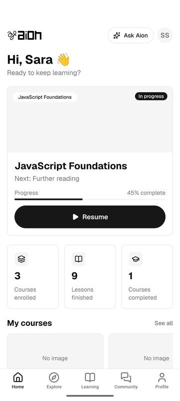
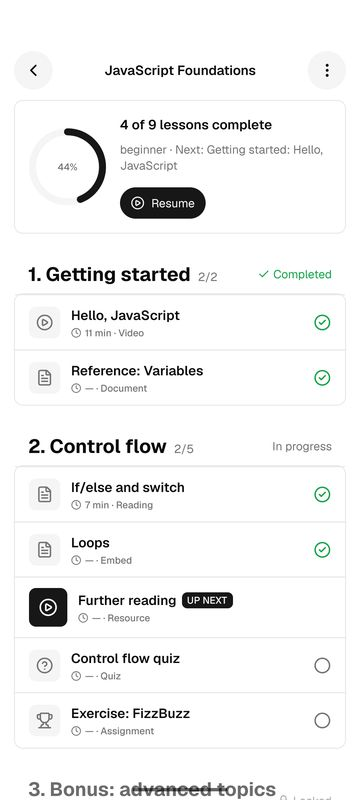
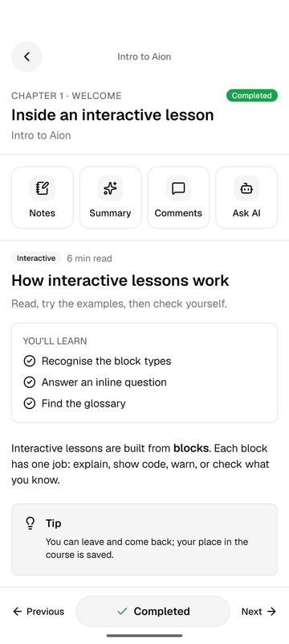
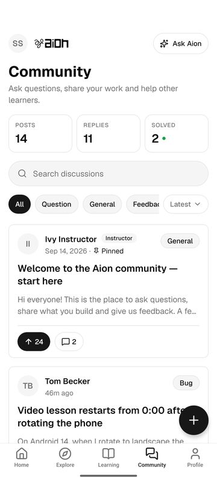
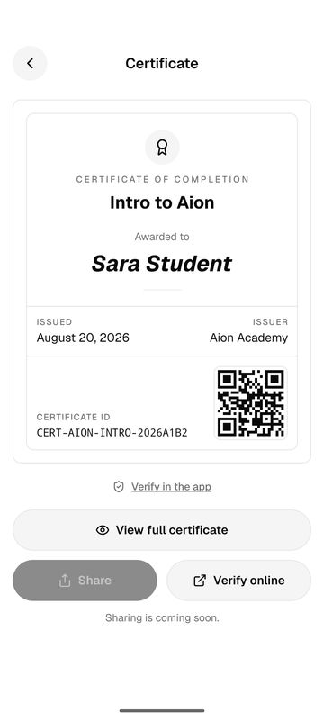
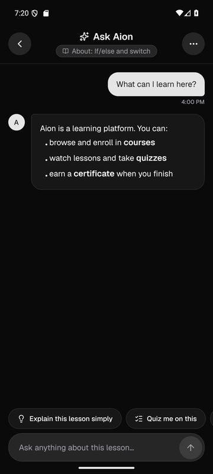
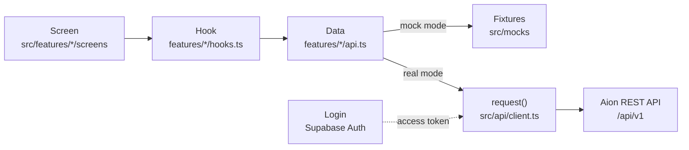

# Aion — Mobile App

The student app for the **Aion** learning platform. Students browse courses, enroll, learn lesson by lesson, take
quizzes and assignments, keep notes, ask an AI tutor, talk in the community, get support and earn verifiable
certificates. Built with Expo and React Native for Android and iOS by Irfan and Maria for a university Mobile App
Development course.

<p>
  
  
  
  
  
  
</p>

---

## Features

- **Account:** sign up, log in, email verification and password reset with 6-digit codes.
- **Discover:** home dashboard with "continue learning", course catalog with search and filters, course detail
  with the full curriculum, free and invite-code enrollment (paid courses open on the web).
- **Learn:** a lesson player for every lesson type (video, YouTube/Vimeo, reading, interactive page, document,
  embed, resource, live session), mark complete, previous/next across chapters, and video resume.
- **Study tools:** timestamped notes, AI summary with key concepts and flip flashcards, quizzes with a review of
  every answer, assignments with file attachments.
- **Ask Aion:** an AI tutor chat that streams its answers and knows which lesson you're on.
- **Community:** forum with search, categories, upvotes, replies and accepted solutions; comments on lessons.
- **Support:** tickets with a chat-style thread.
- **Profile:** learning stats, edit profile with avatar, settings (light / dark / system theme, change password).
- **Certificates:** a certificate card with a QR code, and public verification that works without an account.

---

## How it works



- **Screens never call the network.** Each screen reads data through its feature's hooks
  ([TanStack Query](https://tanstack.com/query)), the hook calls the feature's `api.ts`, and `api.ts` answers from
  fixtures (mock mode) or from the Aion API (real mode). Swapping the data source doesn't touch the screens.
- **Auth:** the app signs in with Supabase and sends the access token on every API call. Sign-up goes through the
  API, which creates the profile.
- **Navigation:** [Expo Router](https://docs.expo.dev/router/introduction/) with route groups for signed-out
  screens, the five tabs, and lesson sheets (notes, AI summary, comments).
- **Design:** one set of theme tokens for light and dark mode, the Geist font, and a shared UI kit in
  `src/components/ui`.

The API is a separate, private service. This repo keeps its contract in [`api/openapi.json`](api/openapi.json)
and our notes on every endpoint in [`docs/API.md`](docs/API.md).

---

## Stack

| Area | Choice |
| :--- | :--- |
| Framework | Expo SDK 57, React Native 0.86, React 19, TypeScript (strict), React Compiler |
| Navigation | Expo Router (typed routes) |
| Data | TanStack Query, `openapi-fetch` + `openapi-typescript`, Zustand for session and settings |
| Auth | `@supabase/supabase-js` with AsyncStorage sessions |
| Forms | react-hook-form + zod |
| Media | expo-video, react-native-webview, expo-image, expo-image-picker, expo-document-picker |
| UI | Reanimated, lucide-react-native, react-native-svg, react-native-marked (markdown), react-native-qrcode-svg |
| Quality | ESLint (`eslint-config-expo`), `tsc`, jest-expo, `scripts/verify.mjs` |

---

## Getting started

### Prerequisites

- Node.js 20 or newer, and npm
- Android Studio with an emulator (or an Android phone with USB debugging); Xcode for iOS on a Mac

### Setup

```bash
git clone <repo-url>
cd aion-mobile
npm install
cp .env.example .env
```

`.env` is never committed. It holds five public settings, checked at startup by
[`src/lib/env.ts`](src/lib/env.ts):

| Variable | What it's for |
| :--- | :--- |
| `EXPO_PUBLIC_API_URL` | Base URL of the Aion API (without `/api/v1`) |
| `EXPO_PUBLIC_SUPABASE_URL` | Supabase project URL |
| `EXPO_PUBLIC_SUPABASE_ANON_KEY` | Supabase public (anon) key |
| `EXPO_PUBLIC_WEB_URL` | Aion web app, for "Get this course on the web" and certificate links |
| `EXPO_PUBLIC_USE_MOCKS` | `true` runs the whole app on built-in sample data; `false` uses the real API |

In mock mode any email and password logs you in, so the app works without a server or accounts.

### Run it

The app uses native modules (video, WebView, file pickers) and embeds its fonts, so run it as a development
build:

```bash
npx expo run:android     # build, install and start on an emulator or device
npx expo run:ios         # macOS only
```

After the first build, `npm start` is enough until native dependencies or `app.json` change.

---

## Scripts

| Command | What it does |
| :--- | :--- |
| `npm start` | Start the Expo dev server |
| `npm run android` / `npm run ios` | Build and run a development build |
| `npm run lint` | ESLint via `expo lint` |
| `npm run typecheck` | TypeScript check (`tsc --noEmit`) |
| `npm test` | Unit tests (jest-expo) |
| `npm run check` | Lint, then typecheck |
| `npm run verify -- check` | The full quality gate: lint, types, tests, and project rules (no hard-coded colors, no network calls in screens, no secrets in the repo) |
| `npm run status` | Progress per phase and the next tasks, read from `docs/TRACKER.md` |
| `npm run api:types` | Regenerate `src/api/schema.d.ts` from `api/openapi.json` |
| `npm run format` | Prettier |

---

## Project layout

```
api/                  OpenAPI snapshot of the backend
assets/               App icon, splash and brand logos
docs/                 Spec, screens, API notes, design images, tracker, work logs
scripts/verify.mjs    Quality gate and project status
src/
  app/                Routes only (Expo Router): one small file per screen, plus layouts
  features/           One folder per area: screens/, components/, hooks.ts, api.ts, schemas.ts
    auth  home  catalog  learning  courses  lesson  quiz  assignment  tutor
    community  support  profile  certificate
  components/ui/      Shared UI kit (Button, Card, TextField, Header, …)
  components/         Markdown renderer, brand logo
  api/                HTTP client, data types, query keys, generated schema
  lib/                Helpers with unit tests: env, course pricing, lesson types, dates, uploads
  mocks/              Sample data and in-memory mutations for mock mode
  theme/              Color tokens, fonts, light/dark mode
```

---

## Team

| Person | Owns |
| :--- | :--- |
| **Irfan** | Home, Explore, My Learning, course detail and curriculum, the lesson player, notes, AI summary, quiz, assignment and AI tutor (S07–S17); API client, Supabase setup, builds and release |
| **Maria** | Sign-up and login flows, lesson comments, community forum, support tickets, profile, settings, certificates and verification (S01–S06, S18–S29); media upload helper |

---

## Docs

- [`docs/CONTEXT.md`](docs/CONTEXT.md): what the project is, constraints and the decision log
- [`docs/SPEC.md`](docs/SPEC.md): technical spec (stack, folders, data layer, auth, design system, quality gates)
- [`docs/SCREENS.md`](docs/SCREENS.md): all 29 screens with their acceptance lists
- [`docs/DESIGN.md`](docs/DESIGN.md): the visual design of every screen
- [`docs/API.md`](docs/API.md): every endpoint the app uses, as the backend actually behaves
- [`docs/INTEGRATION.md`](docs/INTEGRATION.md): the plan for connecting the app to the real API
- [`docs/TEAM.md`](docs/TEAM.md): who owns what
- [`docs/TRACKER.md`](docs/TRACKER.md): every task and how to pick up work

---

## License

[MIT](LICENSE). Aion Mobile contributors, 2026.
